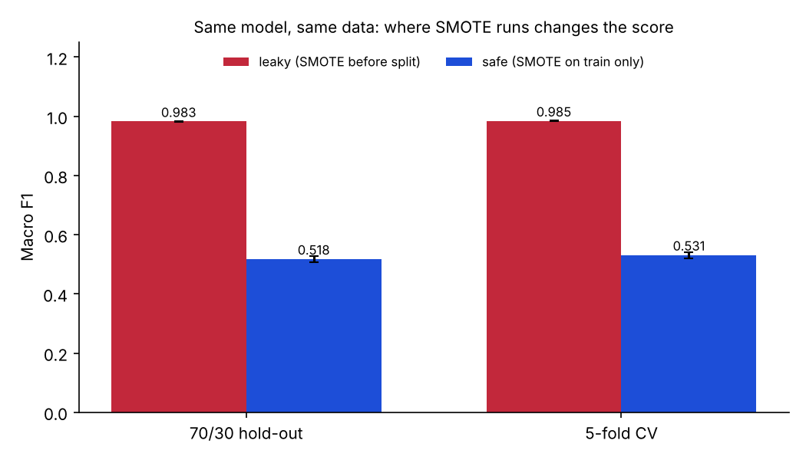

# SMOTE leakage in intrusion-detection evaluation

**Where you run SMOTE can turn a 0.52 model into a "0.98" model.**

Intrusion-detection datasets are heavily imbalanced: most traffic is normal and some attack classes are rare. SMOTE is the usual fix, because it creates synthetic minority samples by interpolating between real ones. If you oversample **before** splitting into train and test, two problems follow. Synthetic points built from test samples leak into training, and synthetic points also land in the test set. The model is then partly graded on data it has effectively already seen.

This repo measures how big that effect is. The same Random Forest is trained on the same data under two protocols:

| Protocol | What happens |
|---|---|
| **Leaky** | SMOTE on the whole dataset → split / cross-validate |
| **Safe** | Split first → SMOTE on the training data only (inside each CV fold via an `imblearn` `Pipeline`) → evaluate on untouched data |



## Results

Synthetic IDS-shaped data: 8,000 rows, 30 features, 5 classes (82 / 10 / 5 / 2 / 1 %). Mean ± std over 5 seeds.

| Setting | Protocol | Macro F1 | Accuracy | Recall, rarest class |
|---|---|---|---|---|
| 70/30 hold-out | Leaky | 0.983 ± 0.002 | 0.983 ± 0.002 | 0.997 ± 0.003 |
| 70/30 hold-out | **Safe** | **0.518 ± 0.010** | **0.869 ± 0.004** | **0.074 ± 0.039** |
| 5-fold CV | Leaky | 0.985 ± 0.001 | – | – |
| 5-fold CV | **Safe** | **0.532 ± 0.010** | – | – |

The leaky protocol claims the model finds the rarest attack 99.7 % of the time. Evaluated honestly, it finds it about 7 % of the time. The model is identical in both cases. Only the evaluation changed.

Full numbers: [`results/results_summary.csv`](results/results_summary.csv) · per-seed: [`results/results_raw.csv`](results/results_raw.csv)

## Why this matters to me

I hit this in my own final-year project, [SLAI-IPS](https://jihadseif.github.io/#slai-ips), an AI-driven intrusion prevention system for MQTT smart-home networks. My early scores were inflated by resampling before the split. I rebuilt the evaluation (stratified 70/30 split, SMOTE on training data only, an untouched test partition, cross-validation), and the corrected held-out results are the ones I report and presented at ICACIn'26. This repo isolates that mistake so it is easy to see and easy to avoid.

## Run it

```bash
pip install -r requirements.txt
python leakage_demo.py                      # synthetic data, ~5 min on a laptop
python leakage_demo.py --seeds 2 --n 4000   # quicker run
```

### On your own data

Any CSV with numeric feature columns and a label column works. Examples include a feature export of [MQTT-IoT-IDS2020](https://ieee-dataport.org/open-access/mqtt-iot-ids2020-mqtt-internet-things-intrusion-detection-dataset), CIC-IDS2017 or UNSW-NB15.

```bash
python leakage_demo.py --csv features.csv --label target
```

Non-numeric columns are dropped and missing values are filled with 0. Clean your data first if that is not what you want.

Outputs go to `results/`: `results_raw.csv`, `results_summary.csv` and `leakage_macro_f1.png`. Use `--plot-only` to redraw the chart from an existing `results_raw.csv`.

## Notes and limits

- The headline numbers come from **synthetic** data. They show the size of the effect under controlled conditions, not the performance of any real IDS. On real data the gap depends on class balance, feature overlap and how many near-duplicate flows the dataset contains.
- Duplicate or near-duplicate flows, which are common in IoT captures, cause a related leak even without SMOTE. Deduplicate before splitting, or split by time or capture session.
- Macro F1 and per-class recall are reported because accuracy hides failures on rare attack classes.

## Licence

MIT. See [LICENSE](LICENSE).
